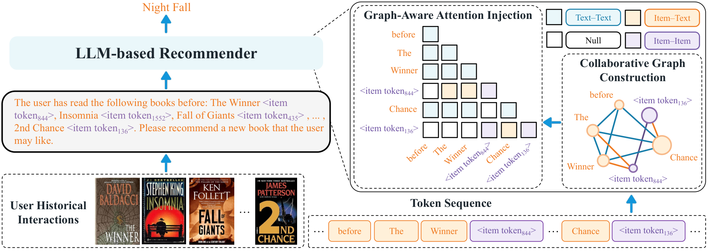

# GALLM

Official code for **[Making Collaborative Signals Count: Graph-Aware Large Language Models for Sequential Recommendation](https://arxiv.org/abs/2608.12184)**.

Fenglin Yan, Bohao Wang, Jian Zhang, Yu Cui, Tongya Zheng, Ye Feng, Can Wang, and Jiawei Chen.

[](https://arxiv.org/abs/2608.12184)
[Paper PDF](https://arxiv.org/pdf/2608.12184) · [Citation](#citation)

GALLM brings collaborative signals into LLM attention through three learnable relations: **Item–Item**, **Item–Text**, and **Text–Text**. This repository includes GALLM, BigRec and LLaRA comparison modes, and four processed datasets.

## Overview

[](https://arxiv.org/abs/2608.12184)

GALLM augments item titles with collaborative item tokens, then constructs a graph over the resulting prompt. Item–Item relations encode global co-occurrence, Item–Text relations align items with their descriptions, and Text–Text relations preserve semantic dependencies. Learnable relation biases inject this graph into LLM attention without an additional graph encoder.

*Figure 2 from the [paper](https://arxiv.org/abs/2608.12184). Click the figure to open the paper.*

## Installation

Use Python 3.10+ and a CUDA GPU. The paper uses LLaMA-3.2-3B; supply an accessible Hugging Face model ID or local Llama checkpoint.

```bash
git clone https://github.com/21039697/GALLM.git
cd GALLM
python -m venv .venv
source .venv/bin/activate
pip install -r requirements.txt
```

On Windows, activate with `.\.venv\Scripts\Activate.ps1` and add `--no-8bit` to training commands. The custom model currently supports Llama architectures.

## Datasets

Processed data, SASRec item embeddings, and item co-occurrence matrices are included under `data/`.

| Dataset argument | Dataset | Train sequences | Test sequences | Catalog items |
| --- | --- | ---: | ---: | ---: |
| `Toy` | Amazon Toys and Games | 10,000 | 4,794 | 11,758 |
| `Clothing` | Amazon Clothing | 10,000 | 5,000 | 22,948 |
| `Amazon_Books` | Amazon Books | 10,000 | 4,383 | 6,344 |
| `Movielens` | MovieLens-10M | 10,000 | 5,000 | 10,681 |

Each directory contains `train_10000.csv`, `test_5000.csv`, `id2name4Rec.json`, `item_embeddings.pth`, and `cooc_matrix.json`. The filename is a sample label; actual row counts are shown above. Each `item_ids` sequence ends with its next-item target; ID `0` is padding.

```bash
python scripts/check_data.py
```

See [data preparation](docs/data.md) for the schema, original sources, artifact checks, and regeneration steps.

## Train, predict, and evaluate

Run from the repository root. These commands use the supplied Clothing artifacts; change `--dataset` to run another dataset.

```bash
python train.py --dataset Clothing --mode gallm \
  --base-model meta-llama/Llama-3.2-3B \
  --output-dir outputs/Clothing/gallm/run-01 \
  --batch-size 64 --micro-batch-size 8 --epochs 5

python inference.py --dataset Clothing --mode gallm \
  --base-model meta-llama/Llama-3.2-3B \
  --checkpoint outputs/Clothing/gallm/run-01/final \
  --num-beams 10 --top-k 10 \
  --output outputs/Clothing/gallm/run-01/predictions.json

python evaluate_batch_match.py \
  --predictions outputs/Clothing/gallm/run-01/predictions.json \
  --top-k 5,10
```

Use the same base model for training and inference. Restricted Hugging Face checkpoints require authentication. Add `--no-compile` to inference when TorchInductor is unavailable. Metrics use exact title matching after whitespace and enclosing-quote normalization.

Change `--mode` in both training and inference to run the included comparisons:

| Mode | Text history | SASRec embeddings | Graph attention biases |
| --- | :---: | :---: | :---: |
| `bigrec` | yes | | |
| `llara` | yes | yes | |
| `gallm` | yes | yes | yes |

[Detailed usage](docs/usage.md) covers multi-GPU commands, optimizer settings, checkpoints, and decoding options. Use `--help` on each script for all arguments.

## Code layout

```text
data/                       Processed datasets and supplied artifacts
model/gallm.py              Item projection and graph-aware attention
model/*decoding.py          Constrained beam search
SASRec/                     SASRec training and embedding export
recommendation_data.py      Prompt construction and batching
data_utils.py               Dataset loading and validation
train.py                    LoRA training
inference.py                Recommendation generation
evaluate_batch_match.py     HR and NDCG evaluation
scripts/check_data.py       Dataset and artifact validation
docs/                       Data and advanced usage documentation
```

**Reproduction note:** this release contains sampled train/test CSVs and no validation CSVs. The existing SASRec routine selects checkpoints on test NDCG@10. This differs from the paper's described train/validation/test protocol; see [data preparation](docs/data.md#evaluation-protocol) before comparing results.

## Citation

If you find this work useful, please cite our paper:

```bibtex
@article{yan2026gallm,
  title   = {Making Collaborative Signals Count: Graph-Aware Large Language Models for Sequential Recommendation},
  author  = {Yan, Fenglin and Wang, Bohao and Zhang, Jian and Cui, Yu and Zheng, Tongya and Feng, Ye and Wang, Can and Chen, Jiawei},
  journal = {arXiv preprint arXiv:2608.12184},
  year    = {2026},
  eprint  = {2608.12184},
  archivePrefix = {arXiv},
  primaryClass  = {cs.IR},
  doi     = {10.48550/arXiv.2608.12184},
  url     = {https://arxiv.org/abs/2608.12184}
}
```

Machine-readable citation metadata are available in [CITATION.cff](CITATION.cff).
